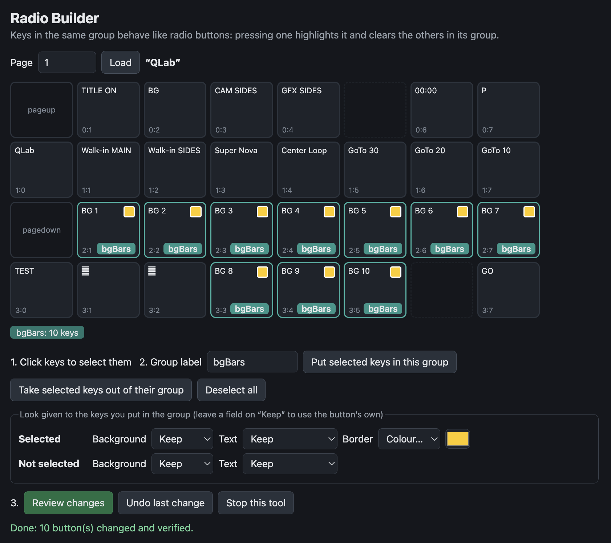

# Companion Radio Builder

Make Bitfocus Companion keys work like radio buttons: press one key in a group
and it lights up, and the others go back to normal.

It works on buttons you have already made. It changes only how they look: their
actions stay the same.

Needs Companion 5 (tested with 5.2) and Python 3.



## Quick start

### macOS

1. Install Python 3 from [python.org](https://www.python.org/downloads/).
2. Download this repository (**Code** → **Download ZIP**) and double-click the ZIP to unzip it.
3. Double-click **Start Radio Builder.command**. If macOS blocks it, open
   **System Settings** → **Privacy & Security** and click **Open Anyway**.
4. In the page that opens, enter your Companion's address and click **Connect**.

### Windows

1. Install Python 3 from [python.org](https://www.python.org/downloads/).
2. Download this repository (**Code** → **Download ZIP**), right-click the ZIP
   and choose **Extract All**.
3. Double-click **Start Radio Builder.bat**. If Windows warns about it, choose
   to run it anyway.
4. In the page that opens, enter your Companion's address and click **Connect**.

### Linux

1. Download this repository (**Code** → **Download ZIP**), then run:
   ```sh
   cd ~/Downloads
   unzip companion-radio-builder-main.zip
   cd companion-radio-builder-main
   python3 radio-ui.py --open
   ```
2. In the page that opens, enter your Companion's address and click **Connect**.

### Companion Pi

This installs the tool on the Pi, ready to start at any time. Log in to the Pi
(ssh) and run:

```sh
curl -L https://github.com/jpkelly/companion-radio-builder/archive/refs/heads/main.tar.gz | tar xz
cd companion-radio-builder-main
sudo bash install.sh
sudo systemctl start radio-ui
```

Open `http://<pi-name>.local:8088`. The tool stops after 30 idle minutes. To
start it again, run `sudo systemctl start radio-ui`.

## Use

1. Load a page.
2. Click the keys for a group, type a name, and click **Put selected keys in this group**.
3. Pick the colours, click **Review changes**, then apply.

**Undo last change** puts the page back. Applying replaces the page in
Companion, so don't do it during a show. To stop the tool, click **Stop this
tool**.
